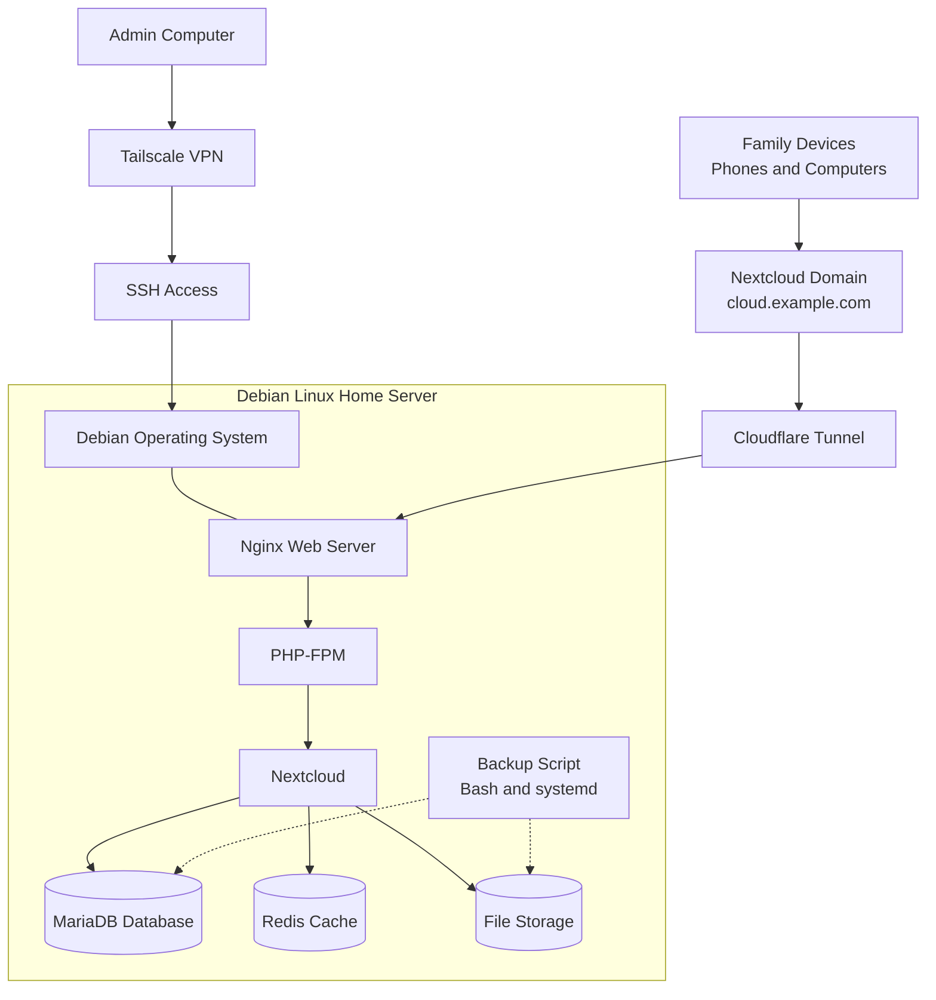

# Nextcloud Home Server Architecture

This diagram shows how my Nextcloud home server is connected and how the main services work together.

Family members access Nextcloud through the domain and Cloudflare Tunnel.

Nginx handles web requests and passes PHP requests to PHP-FPM, which runs the Nextcloud application.

MariaDB stores application information, Redis provides caching, and file storage holds the uploaded files.

Server administration is done separately using Tailscale and SSH.

A Bash script creates backups of the database and Nextcloud files. The backup process is scheduled using systemd.
